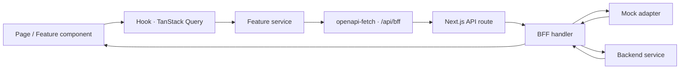

# TalentAI Web

TalentAI Web là ứng dụng web tuyển dụng cho khách tìm việc, ứng viên, nhà tuyển dụng và quản trị viên. Repository này chứa **frontend Next.js và lớp BFF** (Backend for Frontend); các dịch vụ xác thực, việc làm, công ty, hồ sơ và ứng tuyển chạy riêng.

Ứng viên có thể tìm việc, xem chi tiết, quản lý hồ sơ và CV, nộp và theo dõi hồ sơ ứng tuyển. Nhà tuyển dụng quản lý công ty, tin tuyển dụng và ứng viên. Khu vực quản trị phục vụ quản lý hệ thống. Một số màn hình AI và nghiệp vụ đang phát triển; xem [trạng thái triển khai](docs/project-status.md) trước khi giới thiệu một chức năng là đã hoàn thiện.

## Công nghệ

- Next.js App Router, React, TypeScript, Tailwind CSS và Base UI cho giao diện.
- TanStack Query quản lý dữ liệu phía client; `openapi-fetch` gọi API có kiểu.
- Zod kiểm tra form, tham số URL và phản hồi ở ranh giới BFF.
- Vitest, Playwright, ESLint và TypeScript phục vụ kiểm tra mã nguồn.
- [contracts/openapi.yaml](contracts/openapi.yaml) là nguồn sự thật về API. `src/lib/api/generated/schema.d.ts` được sinh tự động, không sửa tay.

Trình duyệt chỉ gọi API cùng origin tại `/api/bff/*`. Frontend không gọi trực tiếp backend hoặc nhà cung cấp AI.

## Các khu vực

| Khu vực | Route chính | Nội dung |
| --- | --- | --- |
| Công khai | `/`, `/jobs`, `/jobs/[jobId]`, `/companies`, `/companies/[companyId]` | Trang chủ, tìm kiếm và xem việc làm/công ty. |
| Tài khoản | `/login`, `/register` | Đăng nhập, đăng ký và khôi phục mật khẩu. |
| Ứng viên | `/candidate/*` | Dashboard, hồ sơ, tiêu chí tìm việc, CV, việc đã lưu và ứng tuyển. |
| Nhà tuyển dụng | `/recruiter/*` | Hồ sơ công ty, tin tuyển dụng và quản lý ứng viên. |
| Quản trị | `/admin/*` | Quản lý hệ thống và báo cáo. |

`src/app/layout.tsx` đặt provider dùng chung. Các nhóm route có layout riêng. Layout ứng viên gọi `requireRole("candidate")` trước khi render; layout nhà tuyển dụng kiểm tra role và công ty. `SessionProvider` cung cấp trạng thái tài khoản cho giao diện client; quyền truy cập route và API được kiểm tra phía server.

## Pipeline kiến trúc khi ứng dụng chạy



1. `src/app/` ghép trang và layout. Logic giao diện theo nghiệp vụ nằm trong `src/features/`; thành phần dùng chung nằm trong `src/components/`.
2. Component tương tác gọi hook. Hook dùng TanStack Query cho loading, lỗi, cache và tải lại. Service gọi `src/lib/api/client.ts` bằng kiểu sinh từ OpenAPI.
3. API client gọi `/api/bff/*`. Route `src/app/api/bff/[...path]/route.ts` chuyển request đến `src/server/bff/handler.ts`.
4. BFF kiểm tra, ánh xạ và chuyển request sang mock hoặc backend theo cấu hình **trên server**. UI và service không cần biết nguồn dữ liệu đang chạy.
5. Phản hồi được chuẩn hóa theo contract frontend; component hiển thị dữ liệu cùng trạng thái loading, empty hoặc error.

Với dữ liệu cần có ngay khi mở trang, Server Component có thể gọi BFF nội bộ rồi truyền dữ liệu ban đầu cho Client Component. Trang chủ dùng `src/server/bff/public/home.ts` để tải việc làm và công ty theo cách này.

### Ví dụ: tìm kiếm việc làm

```text
Ô tìm kiếm trên / hoặc /jobs
  → JobSearch tạo URL /jobs?q=...&provinceCode=...&jobType=...
  → JobList đọc và kiểm tra tham số URL
  → useJobs → getJobs → GET /api/bff/jobs
  → BFF chuyển bộ lọc sang job service hoặc lọc fixture mock
  → JobList hiển thị JobCard, tổng số kết quả và phân trang
```

Bộ lọc nằm trong URL để tải lại trang, dùng Back/Forward và chia sẻ liên kết mà vẫn giữ tiêu chí. Trang kết quả kiểm tra URL bằng Zod trước khi gọi API. Đổi sắp xếp hoặc trang làm đổi query key và tải danh sách tương ứng. Code chính nằm ở `src/features/jobs/components/job-search.tsx`, `job-list.tsx`, `src/lib/jobs/validation.ts` và `src/server/bff/public/job-service.ts`.

### Ví dụ: xác thực và phân quyền

```text
Form đăng nhập → auth service frontend → /api/bff/auth/*
  → BFF auth → auth service Java → BFF đặt cookie HttpOnly
  → server layout kiểm tra session/role trước khi render trang riêng
  → SessionProvider gọi /me để hiển thị tài khoản trong giao diện
```

Auth **luôn dùng auth service thật**, độc lập với chế độ mock/real của dữ liệu nghiệp vụ. BFF không tin role do trình duyệt tự khai báo để cấp quyền. Request thay đổi dữ liệu cần kiểm tra phiên và CSRF. Xem [luồng xác thực](docs/auth-flow.md) và [làm mới phiên](docs/session-refresh.md).

## Mock và backend thật

`DATA_MODE=mock` là mặc định cho dữ liệu nghiệp vụ. Có thể bật real theo từng nhóm bằng `JOB_DATA_MODE`, `COMPANY_DATA_MODE`, `PROFILE_DATA_MODE` và `APPLICATION_DATA_MODE`; khi không đặt, nhóm đó dùng `DATA_MODE`. Mọi request backend đi từ BFF đến gateway qua một biến server-only `BACKEND_API_URL`. Auth và thông báo vẫn dùng gateway khi dữ liệu nghiệp vụ ở chế độ mock.

Ví dụ chỉ nối việc làm và công ty với backend thật trong `.env.local`:

```dotenv
DATA_MODE=mock
JOB_DATA_MODE=real
COMPANY_DATA_MODE=real
BACKEND_API_URL=http://localhost:3000/api/v1
```

Bật real cho một dịch vụ không có nghĩa mọi màn hình liên quan đã tích hợp thật. Một số luồng còn mock, một số màn hình là bản xem trước. Xem [docs/project-status.md](docs/project-status.md) và tài liệu tích hợp trong `docs/` trước khi demo. Riêng trang chủ, danh sách việc làm/công ty đi qua BFF, nhưng số việc làm, số ứng viên, thẻ ngành và bài cẩm nang vẫn có nội dung minh họa từ `src/mocks/fixtures/home.ts`.

## Chạy ở máy cá nhân

Yêu cầu Node.js 22 và npm. Trên PowerShell:

```powershell
npm.cmd ci
Copy-Item .env.example .env.local
npm.cmd run dev
```

Mở `http://localhost:3000`. Trang tìm việc ở `/jobs`; bộ UI dùng chung ở `/ui`. Dữ liệu nghiệp vụ mock không cần backend nghiệp vụ, nhưng **đăng nhập/đăng ký vẫn cần gateway và auth service**. FE và gateway phải dùng hai cổng host khác nhau; nếu FE dùng 3000, chuyển cổng host của gateway và cập nhật `BACKEND_API_URL` tương ứng. Khi đổi cấu hình trong `.env.local`, khởi động lại Next.js. Không commit file môi trường cá nhân. Nếu PowerShell cho phép chạy `npm.ps1`, có thể dùng `npm` thay `npm.cmd`.

## Cấu trúc thư mục

```text
src/
├── app/                 Route, page, layout và API route của Next.js
├── components/          UI và thành phần dùng chung
├── features/            Component, hook, service, schema theo nghiệp vụ
├── lib/                 API client, auth, helper và kiểu dùng chung
├── mocks/fixtures/      Dữ liệu mẫu theo contract
├── providers/           Query, session, theme và provider giao diện
└── server/bff/          Auth, mock adapter, proxy và adapter backend
contracts/              OpenAPI contract và ví dụ request/response
docs/                   Tài liệu từng luồng và trạng thái tích hợp
tests/                  Unit test và E2E
```

Hướng phụ thuộc chính: `app → features → components/lib`; `server/bff → lib/mocks`. Feature khác được dùng qua `index.ts` của feature đó. Code chỉ chạy trên server không được import vào Client Component.

## Pipeline phát triển và kiểm tra

Khi thêm hoặc thay đổi API:

```text
OpenAPI contract → ví dụ API → gen:api → mock/adapter BFF
                 → feature service → hook → UI → kiểm tra
```

Đọc [AGENTS.md](AGENTS.md) và workflow trong `.agent/workflows/`. Không sửa trực tiếp kiểu API tự sinh hoặc tạo phản hồi thành công giả cho endpoint chưa có.

| Lệnh | Mục đích |
| --- | --- |
| `npm.cmd run dev` | Chạy ứng dụng ở chế độ phát triển. |
| `npm.cmd run typecheck` | Kiểm tra kiểu TypeScript. |
| `npm.cmd run lint` | Kiểm tra ESLint và ranh giới import. |
| `npm.cmd run test` | Chạy Vitest. |
| `npm.cmd run test:e2e` | Chạy Playwright. |
| `npm.cmd run build` | Tạo production build. |
| `npm.cmd run start` | Chạy production build đã tạo. |
| `npm.cmd run contract:lint` | Kiểm tra OpenAPI contract. |
| `npm.cmd run gen:api` | Sinh lại kiểu API từ contract. |
| `npm.cmd run mock` | Chạy Prism độc lập để khám phá contract; không cần cho `dev`. |

CI trong `.github/workflows/ci.yml` chạy khi push hoặc mở pull request: cài dependencies → lint contract → sinh và kiểm tra API types → typecheck → lint → unit test → build → E2E Chromium. Đây là pipeline kiểm tra mã nguồn; nghiệm thu với backend thật vẫn cần làm riêng theo từng dịch vụ.

## Tài liệu liên quan

- [Trạng thái triển khai](docs/project-status.md) và [kiến trúc BFF](src/server/bff/README.md).
- [Luồng xác thực](docs/auth-flow.md), [tích hợp job service](docs/job-posting-integration.md), [tích hợp company service](docs/company-service-integration.md).
- [Theo dõi hồ sơ ứng tuyển](docs/candidate-application-tracking.md), [hồ sơ ứng viên](docs/candidate-profile-integration.md), [quản lý CV](docs/cv-integration.md).
- [Quy chuẩn giao diện](docs/ui-spec.md).
