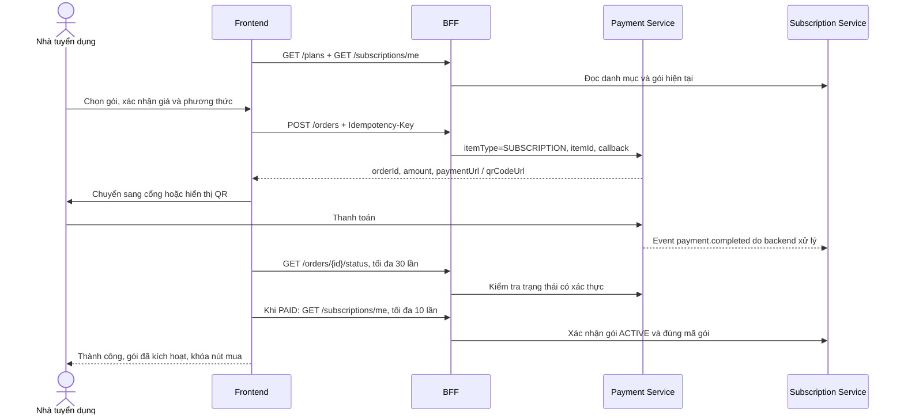

# Báo cáo luồng đăng ký gói và thanh toán frontend

Ngày thực hiện: 27/11/2026. Phạm vi: gói dịch vụ của **nhà tuyển dụng**.

## Luồng thống nhất

Đã đọc Swagger qua `/docs/initializer.js`, `/docs/openapi/sub` và `/docs/openapi/pay` trước khi code.

Subscription Service không có API tạo subscription trả phí từ frontend. Theo xác nhận của người yêu cầu, FE lấy ID gói và tạo đơn qua Payment Service; Subscription Service tự kích hoạt khi nhận event `payment.completed`. **Tạo đơn chưa kích hoạt gói.**



## API và cấu hình

Frontend chỉ gọi `/api/bff/*`. BFF lấy gateway từ biến server-only `BACKEND_API_URL`.

| API BFF | API gateway | Mục đích |
| --- | --- | --- |
| `GET /plans` | `GET /api/v1/plans` | Giữ danh mục hiện có |
| `GET /subscriptions/me` | `GET /api/v1/subscriptions/me` | Gói hiện tại và hạn mức |
| `POST /orders` | `POST /api/v1/orders` | Tạo đơn và thông tin thanh toán |
| `GET /orders/{id}` | `GET /api/v1/orders/{id}` | Chi tiết đơn và số tiền |
| `GET /orders/{id}/status` | `GET /api/v1/orders/{id}/status` | Polling trạng thái |
| `POST /orders/{id}/cancel` | `POST /api/v1/orders/{id}/cancel` | Hủy đơn theo điều kiện backend |

Request tạo đơn gồm `itemType: "SUBSCRIPTION"`, `itemId` từ danh mục, `returnUrl` và `cancelUrl`. Callback là `<origin FE>/recruiter/billing/result?checkout=<UUID>&result=return|cancel`.

- Header `Idempotency-Key: <UUID>` giữ nguyên khi thử lại cùng lần mua chưa rõ kết quả.
- VietQR / chuyển khoản: **bỏ paymentMethod**. MoMo gửi `MOMO`, ZaloPay gửi `ZALOPAY`.
- Không gửi `amount`: giá do backend quyết định. Nếu giá/tiền tệ của đơn khác giá đã xác nhận, FE yêu cầu đồng ý lại trước khi chuyển sang cổng.
- Contract BFF mở phạm vi mua gói và phương thức UI cần dùng, thêm validation callback, CSRF và idempotency bắt buộc; không tạo endpoint backend không có trong Swagger.
- `SUBSCRIPTION_DATA_MODE=mock|real` dùng chung cho danh mục, thuê bao và đơn để tránh mock gói nhưng tạo đơn thật. Real phải cấu hình `BACKEND_API_URL=<gateway>/api/v1` và restart FE.

## UI, trạng thái và polling

Giữ card, bảng so sánh, màu sắc và component Modal/Button/RadioGroup hiện có. Bổ sung gói hiện tại, ngày hết hạn, badge **Đang sử dụng**, khóa nút mua đúng gói ACTIVE; xác nhận tên gói, thời hạn, tổng tiền và phương thức trước khi gửi. Nút có spinner và chốt đồng bộ chống double submit.

Route `/recruiter/billing/result` hiển thị kết quả, mã đơn, số tiền, nút quay lại và thông tin thanh toán nếu còn chờ. Redirect theo paymentUrl hợp lệ; nếu chỉ có QR thì mở trang kết quả hiển thị ảnh. Dữ liệu QR dạng chuỗi được hiển thị nguyên bản, không tự suy đoán nội dung chuyển khoản.

| Trạng thái Payment Service | UI |
| --- | --- |
| CREATED, PENDING | Đang xử lý, thông tin thanh toán, cho xác nhận hủy |
| PAID | Thành công; kiểm tra riêng kích hoạt gói |
| FAILED | Thanh toán thất bại |
| CANCELLED | Thanh toán đã hủy |
| EXPIRED | Đơn thanh toán hết hạn |
| REFUNDED | Giao dịch đã hoàn tiền |

Query `status=PAID`, `result=success` hoặc quay về cancelUrl không tự đổi trạng thái. API có xác thực là nguồn kết quả. Callback hủy nhưng API còn PENDING sẽ hiện giải thích và bước xác nhận hủy qua API.

Polling thanh toán: mỗi 3 giây, tối đa 30 lần gọi mỗi lượt (tính cả request bị hủy); dừng ở trạng thái kết thúc hoặc lỗi. Hết lượt vẫn là đang xử lý, có nút kiểm tra lại. Không tiếp tục ngầm khi focus tab hoặc reconnect sau khi đã dừng. Request được hủy khi rời trang.

Sau PAID, đọc gói tối đa 10 lần, mỗi 3 giây. Chỉ báo kích hoạt khi ACTIVE và đúng plan.code tương ứng ID gói đã mua. Nếu event còn xử lý, gói bị gỡ khỏi danh mục hoặc tải lỗi, vẫn giữ thông báo thanh toán thành công và cho kiểm tra lại; không yêu cầu trả tiền lại. Kích hoạt thành công cập nhật cache; bảng giá cũng refetch khi mở/focus.

Tiền VNĐ và ngày dd/MM/yyyy dùng helper chung. Modal có label, focus trap, hỗ trợ bàn phím; bố cục linh hoạt cho mobile/desktop. Lỗi ánh xạ sang tiếng Việt, không hiện chi tiết kỹ thuật upstream.

## Session và khôi phục

- Token giữ trong cookie HttpOnly. BFF xác thực recruiter; thao tác ghi cần origin/CSRF hợp lệ. Backend kiểm tra quyền sở hữu; mock cũng tách đơn theo user.
- Không lưu token, thông tin thẻ/ngân hàng trong localStorage.
- sessionStorage chỉ giữ ID gói, phương thức, ID đơn, khóa idempotency và cờ kết thúc. Callback dùng checkout UUID tìm đơn khi provider dùng orderId định dạng riêng. Sau khi xác định đơn, chuẩn hóa URL thành `?orderId=<UUID>` để reload được.
- Lỗi mạng sau khi tạo đơn: thử lại cùng khóa, không tự retry POST. Lần mua chưa rõ kết quả ngăn đổi gói/phương thức trong cùng tab để tránh tạo thêm đơn. Lỗi request bị từ chối rõ ràng cho phép tạo lại.
- Nếu trình duyệt chặn sessionStorage, báo lỗi trước lần tạo đơn mới. Mất dữ liệu tab cần đường dẫn có ID đơn, không đoán giao dịch từ query trạng thái.
- Chặn redirect không an toàn và URL có credentials. HTTPS được phép; HTTP giới hạn cùng origin. QR ảnh nhận HTTPS hoặc data URI ảnh raster.
- Gói miễn phí giữ lối Bắt đầu tuyển dụng có sẵn, không tạo giao dịch thanh toán 0 đồng.

## File tạo mới trong task

| File | Vai trò |
| --- | --- |
| `src/app/(recruiter)/recruiter/billing/result/page.tsx` | Route kết quả, searchParams theo Next.js hiện tại |
| `src/features/recruiter-services/services/subscription-api.ts` | API gói hiện tại |
| `src/features/recruiter-services/services/payment-api.ts` | API đơn và trạng thái thanh toán |
| `src/features/recruiter-services/hooks/use-current-subscription.ts` | Query gói hiện tại |
| `src/features/recruiter-services/hooks/use-checkout.ts` | Chốt gửi, idempotency, callback, redirect, xác nhận lại giá |
| `src/features/recruiter-services/hooks/use-payment-result.ts` | Polling thanh toán và kích hoạt có giới hạn |
| `src/features/recruiter-services/checkout-storage.ts` | Khôi phục lần mua, callback với ID đơn |
| `src/features/recruiter-services/payment-presentation.ts` | Nhãn, lỗi, URL an toàn, giới hạn polling |
| `src/features/recruiter-services/components/checkout-dialog.tsx` | Xác nhận gói, giá và phương thức |
| `src/features/recruiter-services/components/checkout-resume.tsx` | Tiếp tục lần mua chưa kết thúc |
| `src/features/recruiter-services/components/payment-instructions.tsx` | Link/QR thanh toán |
| `src/features/recruiter-services/components/payment-result-page.tsx` | UI kết quả và hủy đơn |
| `src/server/bff/recruiter/subscription-checkout.ts` | Session/CSRF/validation, proxy theo Swagger |
| `src/server/bff/recruiter/subscription-checkout-mock.ts` | Đơn/thuê bao mock trong bộ nhớ theo user |
| `src/mocks/fixtures/subscription-checkout.ts` | Fixture có kiểu |
| `contracts/examples/current-subscription.json` | Ví dụ gói hiện tại |
| `contracts/examples/subscription-order.json` | Ví dụ đơn thanh toán |
| `tests/unit/subscription-checkout.test.ts` | Giá server, auth/CSRF, idempotency, trạng thái |
| `tests/unit/payment-presentation.test.ts` | Callback, khôi phục, lỗi, URL an toàn |
| `tests/e2e/subscription-checkout.spec.ts` | Luồng trình duyệt và mobile |
| `tests/support/subscription-auth-server.ts` | Upstream auth chỉ dành cho kiểm thử, chạy cục bộ khi bật flag E2E |
| `docs/subscription-payment-flow.md` | Báo cáo này |

## File có sẵn được bổ sung

Workspace đã có thay đổi trước task. Danh sách này chỉ tính phần thanh toán; giữ nguyên các thay đổi khác.

- `contracts/openapi.yaml`: endpoint/schema BFF theo Swagger.
- `src/lib/api/generated/schema.d.ts`: sinh bằng npm run gen:api, không sửa tay.
- `src/lib/api/subscription-schemas.ts`: validation runtime.
- `src/features/recruiter-services/types.ts`, `query-keys.ts`, `index.ts`: kiểu từ generated contract, query key, public export.
- `src/features/recruiter-services/components/pricing-page.tsx`: đăng ký, gói hiện tại, badge, khóa nút, khôi phục.
- `src/server/bff/handler.ts`, `src/server/bff/mock-adapter.ts`: nối route real/mock.
- `src/lib/env.ts`, `.env.example`: mode dùng chung và gateway từ môi trường.
- `playwright.config.ts`: mode subscription của test server.
- `tests/unit/candidate-detail.test.ts`: sửa hai assertion cũ dùng điểm cố định 78 trong khi fixture hiện có là 92; kiểm tra đúng mục tiêu là giữ nguyên điểm AI của fixture khi parse/lưu đánh giá, không sửa logic hồ sơ ứng viên.
- `docs/recruiter-subscription-plans.md`, `docs/project-status.md`: phạm vi tích hợp.

## Cách test từ đầu đến cuối

### Mock

1. Đặt DATA_MODE=mock, SUBSCRIPTION_DATA_MODE=mock, giữ auth gateway hiện có. Chạy npm run dev, đăng nhập recruiter đã có hồ sơ công ty.
2. Mở /recruiter/pricing; kiểm tra giá/gói hiện tại. Chọn Basic/Pro → xác nhận gói, giá, phương thức.
3. Mock mở trang kết quả, lần kiểm tra thứ ba đổi PENDING → PAID và cập nhật thuê bao đúng user. Quay lại bảng giá kiểm tra badge/nút khóa.
4. Lặp lại MoMo/ZaloPay. Cả ba phương thức trong mock đều mô phỏng, không tạo giao dịch tại cổng thật.
5. Ép header x-mock-scenario: pending | failed | cancelled | expired trên /orders/{id}/status. pending giữ chờ đến giới hạn; error mô phỏng lỗi dịch vụ; empty ở /subscriptions/me mô phỏng chưa có gói. Header mock không chuyển tới upstream real.
6. Kiểm tra hủy pending, reload kết quả, callback hủy, query giả status=PAID, bấm nhiều lần, mất mạng sau khi gửi và thử lại cùng khóa.

Mock trong bộ nhớ server, reset khi restart; fixture dùng thời gian cố định. Auth vẫn dùng gateway hiện tại.

Bộ E2E tạo một tài khoản recruiter kiểm thử riêng cho cả suite và một company mock, dùng lại cookie trong bộ nhớ giữa các case. Flag `SUBSCRIPTION_E2E_AUTH_STUB=1` chạy upstream auth cục bộ tại cổng 3388 để test độc lập gateway, vẫn đi qua logic cookie/session/CSRF BFF thật. File fixture chỉ được import trong test, không mở đường tắt xác thực ở production. Không bật flag thì cần gateway auth hoạt động; nếu auth trả 429, chờ hết giới hạn trước khi chạy lại.

```powershell
npm.cmd run contract:lint
npm.cmd run gen:api
npm.cmd run typecheck
npm.cmd run lint
npm.cmd run test -- --maxWorkers=2 --testTimeout=30000
$env:SUBSCRIPTION_DATA_MODE='mock'
$env:SUBSCRIPTION_E2E_AUTH_STUB='1'
npm.cmd run test:e2e -- tests/e2e/subscription-checkout.spec.ts
npm.cmd run build
```

### Backend và cổng thanh toán thật

1. Đặt SUBSCRIPTION_DATA_MODE=real, BACKEND_API_URL=<gateway>/api/v1, restart FE; đăng nhập recruiter hợp lệ đã có company. UI/service client không đổi.
2. Dùng sandbox đã được backend cấu hình cho các cổng; return/cancel URL phải quay về FE truy cập được. Mua thử từng phương thức bằng tài khoản kiểm thử.
3. Network: POST chỉ có ID gói, loại SUBSCRIPTION, callback và phương thức ví nếu có; không gửi giá hay token trong JSON. Giá/link/QR lấy từ response.
4. Thanh toán sandbox → quay về FE → /orders/{id}/status trả PAID → /subscriptions/me trả đúng gói ACTIVE. Thử callback hủy, giao dịch lỗi, timeout và reload.
5. Khi đã trả tiền nhưng gói chưa đổi, kiểm tra payment.completed và consumer Subscription Service; FE không tự kích hoạt thuê bao.

**Giới hạn nghiệm thu:** mock và test proxy không xác nhận MoMo, ZaloPay, VietQR và Kafka thật đã chạy end-to-end. Kết quả các lệnh kiểm tra của phiên làm việc được cập nhật bên dưới.

## Kết quả kiểm tra

| Kiểm tra | Kết quả |
| --- | --- |
| `npm.cmd run contract:lint` | Pass; còn 4 cảnh báo có sẵn về license và response 4xx của báo cáo vi phạm |
| `npm.cmd run gen:api` | Đã sinh lại schema từ contract |
| `npm.cmd run typecheck` | Pass |
| `npm.cmd run lint` | Pass, 0 lỗi; còn 10 cảnh báo ngoài phần thanh toán |
| `npm.cmd run test -- --maxWorkers=2 --testTimeout=30000` | 78 file, **445 test pass** |
| E2E subscription với auth fixture và payment mock | **7 kịch bản pass** trên Chromium |
| `npm.cmd run build` | Pass, có route động `/recruiter/billing/result` |
| `git diff --check` | Pass |

Giới hạn worker/timeout của unit test nhằm phù hợp filesystem Windows đang chậm, không bỏ qua test nào. Hai assertion cũ của hồ sơ ứng viên được chỉnh để kiểm tra giữ nguyên điểm AI theo fixture hiện tại; không thay đổi logic nghiệp vụ ứng viên.

E2E đã kiểm tra: xác nhận giá, default không gửi paymentMethod, double submit, thành công và reload, badge/khóa mua, thất bại trên mobile 375px, hủy đơn, query giả không quyết định thành công, dừng đúng 30 lần và thử lại thủ công, lỗi mạng sau tạo đơn dùng lại idempotency key, callback có mã tương quan, response chỉ có QR, và PAID trước khi gói kích hoạt. Đã xem ảnh desktop/mobile, kiểm tra không tràn ngang.

Ảnh khi chạy test được lưu trong `test-results/` theo từng kịch bản: `checkout-confirmation-desktop.png`, `checkout-confirmation-mobile.png`, `payment-success-desktop.png`, `payment-failed-mobile.png`. Đây là artifact kiểm thử, không phải tài nguyên ứng dụng.

Chưa thực hiện thanh toán tiền thật, chưa xác nhận callback/webhook của các cổng và luồng Kafka thật. Phần real cần nghiệm thu theo checklist ở trên với sandbox do backend cấu hình.

